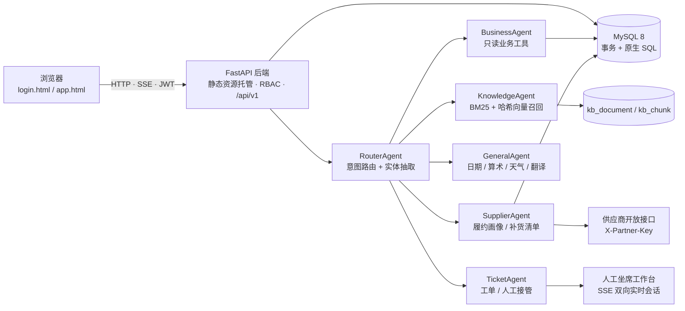

# 智仓云枢（SmartWMS AgentHub）

基于 RAG 与多 Agent 的仓储运营智能协同平台，覆盖 **入库 → 出库 → 库存 → 盘点 → 智能决策 → 智能客服** 全流程。前后端分离架构，业务数据实时联动，内置 RBAC 权限体系、6 Agent 智能客服、人工接管、扫码作业与供应商开放接口，配套 87 项端到端测试。采用 [MIT 协议](LICENSE) 开源。

仓库地址：<https://github.com/hvirgo0724-code/SmartWMS-AgentHub>

***

## 目录

- [技术栈](#技术栈)

- [架构总览](#架构总览)

- [功能特性](#功能特性)

- [智能客服（RAG + 多 Agent）](#智能客服rag--多-agent)

- [供应商 / 商家开放接口](#供应商--商家开放接口)

- [快速开始（Docker 一键部署）](#快速开始docker-一键部署)

- [本地开发运行](#本地开发运行)

- [配置项](#配置项)

- [演示账号](#演示账号)

- [端到端测试](#端到端测试)

- [项目结构](#项目结构)

- [核心 API](#核心-api)

- [数据一致性保障](#数据一致性保障)

***

## 技术栈

| 层   | 技术                                             |
| --- | ---------------------------------------------- |
| 后端  | Python 3.10+ · FastAPI · PyMySQL（原生 SQL，无 ORM） |
| 前端  | 原生 HTML/CSS/JavaScript · Bootstrap 5 · ECharts |
| 数据库 | MySQL 8.0（utf8mb4 / InnoDB）                    |
| 认证  | JWT（HMAC-SHA256）· PBKDF2-HMAC-SHA256 密码哈希      |
| 智能客服 | 自研 RAG（BM25 + 哈希语义向量混合召回）· 多 Agent 编排 · SSE 流式输出 · OpenAI 兼容大模型（可选） |
| 扫码作业 | 扫码枪键盘输入 · BarcodeDetector 摄像头识码 · Web Audio 声音反馈 · 移动端优先布局 |
| 部署  | Docker · Docker Compose（双容器：MySQL + 后端）        |

## 架构总览



- 后端同时托管前端静态资源（`/static`），单服务部署，无需 Nginx。
- 智能客服以 SSE 流式返回各 Agent 轨迹与最终答案，未配置大模型时自动降级为本地检索式回答。

- 所有写操作走数据库事务，异常自动回滚。

- 首次容器启动自动建库建表并灌入演示数据（[docker-entrypoint.sh](backend/docker-entrypoint.sh)）。

## 功能特性

### 基础管理

- 用户 / 角色权限（RBAC，38 项细粒度权限码）

- 多仓库 → 库区 → 库位三级管理（3 仓库 / 15 库区 / 450 库位）

- 商品档案（SKU、批次管理、安全库存上下限）、供应商 / 客户管理

### 入库管理

ASN 收货通知 → 转入库单（自动生成批次）→ 审核 → 确认入库。确认时联动：
库存增加、批次登记、智能推荐上架库位（同类合并 / 温控匹配）、库位状态占用、质检记录、移库流水。

### 出库管理

出库单创建（可用库存预检）→ 审核 → **FIFO 分配**（按批次先进先出，锁定库存与库位）→ 发货确认（扣减库存、恢复库位、出库流水）。支持波次拣货：多订单合并波次、播种式拣货单汇总、一键拣货发货；取消订单自动释放锁定库存。

### 库存管理

多维度实时库存查询（数量 / 锁定 / 可用 + 汇总）、库位间移动、盘盈盘亏调整（联动调整单）、冻结 / 解冻、循环盘点（明盘 / 盲盘，差异自动生成调整单并同步库存）、批次效期跟踪与临期预警。

### 智能决策

数据看板（库存周转、库容利用率、出入库 14 天趋势、ABC 分类）、智能补货建议（近 30 天出库速度 + 安全库存）、上下限 / 滞销 / 缺货预警、路径优化（库位热力图 + 最近邻 + 2-opt）、报表中心（Excel 导出）。

### 智能客服

基于 RAG 的知识问答 + 多 Agent 协作，深度融合现有 WMS 数据：

- **6 个专职 Agent**：意图路由 / RAG 知识检索 / 实时业务查询 / 供应商协同 / 通用问答 / 工单升级，右侧面板实时展示协作轨迹与耗时。
- **通用问答**：支持日期、时间、星期、简单算术、寒暄等非业务问题，不强制走知识库；实时天气通过 Open-Meteo 公开接口查询，翻译/开放域问答由大模型处理。
- **混合检索**：中文二元词 BM25 + 哈希语义向量召回，RRF 式融合排序，按文档去重并返回带编号的知识引用。
- **实时业务工具**：库存、单据状态、预警、补货（支持实时兜底计算）、库容、批次效期、客户出库、供应商履约画像。
- **供应商补货清单**：按商品默认供应商汇总待补货需求，直接对接供应商开放接口创建 ASN。
- **知识库管理**：文档增删改、发布/草稿、自动切片与索引重建、检索测试、命中率与低置信度问题统计。
- **人工接管**：转人工后进入排队，坐席在人工工作台接入会话，双方通过 SSE 实时收发消息；结束服务后自动恢复 AI 客服。
- **工单闭环**：低置信度或用户要求人工时自动创建工单，支持优先级、处理人、解决结论与 SLA。
- **扫码作业**：支持 USB/蓝牙扫码枪键盘输入与浏览器摄像头识码，扫码识别商品、库位、单据，并快捷移库、一键入库/发货；带声音与震动反馈。
- **可选大模型**：配置 OpenAI 兼容接口后使用生成式回答，未配置/调用失败自动降级为本地检索式，功能不中断。

### 系统管理

系统参数与 AI 大模型配置、操作日志审计。

***

## 智能客服（RAG + 多 Agent）

入口：「智能客服 → 客服工作台 / 服务工单 / 知识库管理」，或页面右下角悬浮客服按钮。

### 协作流程

```
用户提问
  └─ RouterAgent        识别意图（库存/单据/供应商/预警/补货/知识/人工）并抽取商品、仓库、供应商、单据号
      ├─ KnowledgeAgent   BM25 + 哈希语义向量混合检索知识库，返回带编号引用
      ├─ BusinessAgent    调用只读业务工具（库存/单据/预警/补货/库容/效期/客户）
      ├─ SupplierAgent    供应商履约画像、默认供货商品、按供应商汇总补货沟通清单
      ├─ ComposeAgent     注入引用与实时数据生成答案（大模型可选，失败自动降级）
      └─ TicketAgent      低置信度 / 用户要求人工时创建工单并跟踪 SLA
```

每次回答都会记录 Agent 轨迹、耗时、命中知识、工具结果、置信度与用户反馈，用于持续优化。

### RAG 实现（零额外依赖，可离线）

| 环节 | 方案 |
| --- | --- |
| 切片 | 按段落/句子边界切分，默认 320 字、60 字重叠，保留语义完整性 |
| 稀疏召回 | 中文单字 + 二元词 + 三元词 BM25（k1=1.5，b=0.75） |
| 语义召回 | 512 维哈希词袋向量 + 余弦相似度，L2 归一化 |
| 融合排序 | 0.58 × BM25 + 0.42 × 向量，标题命中与知识域加权，每篇文档最多 2 个切片 |
| 业务域过滤 | 按意图限定知识分类（如库存查询只检索「库存管理/常见问题/术语」），避免误命中 |
| 引用 | 返回文档编号、标题、分类、匹配分数与片段，前端可点击查看原文 |

知识库、切片与向量存储在 MySQL（`kb_document` / `kb_chunk`），文本变更自动重建索引；无需向量数据库，部署简单。

### 内置业务工具

| 工具 | 能力 |
| --- | --- |
| stock | 商品实时库存、可用/锁定、仓库分布、安全库存判断 |
| order | ASN / 入库单 / 出库单 / 波次 / 质检 / 盘点 / 调整单状态与明细 |
| alerts | 预警统计；日志未生成时实时扫描缺货、超储、临期、滞销 |
| replenishment | 补货建议；表为空时按「近 30 天出库速度 + 安全库存 + 7 天采购周期」实时计算 |
| locations / expiring | 库容利用率、临期与已过期批次 |
| customer / overview | 客户出库概况、今日运营概览 |
| supplier / supplier_plan | 供应商准时率、质检合格率、供货量、履约评分；按供应商汇总补货清单 |

### 大模型配置

支持任意 OpenAI 兼容 `/chat/completions` 服务（通义千问 DashScope、DeepSeek、OpenAI、Ollama/vLLM 等）。

推荐在「系统管理 → 参数配置 → AI 大模型配置」中填写 Base URL、模型名称和 API Key，保存后点「测试连接」验证；密钥仅管理员可配置，接口返回时自动脱敏。也可用环境变量：

```bash
WMS_LLM_BASE=https://dashscope.aliyuncs.com/compatible-mode/v1
WMS_LLM_KEY=sk-xxxx
WMS_LLM_MODEL=qwen-plus
WMS_LLM_TIMEOUT=30
```

环境变量优先级高于系统参数。未配置或调用失败时自动降级为本地检索式回答，客服功能不中断。

- 翻译、开放域问答：走大模型。
- 实时天气：走 Open-Meteo（无需密钥），大模型只负责组织语言。
- 库存、单据、供应商数据：仍由业务工具查询，禁止模型编造。

配置接口：`GET /configs/llm`（脱敏查看）、`PUT /configs/llm`（保存）、`POST /configs/llm/test`（连通性测试）。

### 人工接管与实时会话

支持从 AI 客服平滑切换到人工坐席，双方通过 SSE 实时收发消息：

1. 用户点击「转人工」或输入“转人工客服”，系统创建工单并将会话状态置为 `waiting`，消息进入人工队列。
2. 坐席在「智能客服 → 人工工作台」查看排队工单，点击「接入会话」，会话状态变为 `human`，并写入“人工客服 XX 已接入”的系统提示。
3. 用户与坐席通过 `GET /api/v1/cs/sessions/{id}/events` 长连接实时接收新消息；人工模式下用户消息只入库转交坐席，不再触发 AI 回答。
4. 坐席填写处理结论并「结束服务」后，工单变为 `resolved`，会话恢复 `active`，智能客服自动接管；全程消息、状态与处理结论均可追溯。

同一会话存在未关闭工单时自动复用，避免重复排队；人工排队列表每 5 秒刷新，会话内消息通过事件流实时推送。

### 权限

新增 4 个权限码：`cs:view`（使用客服）、`cs:kb`（知识库管理）、`cs:ticket`（工单处理与人工工作台）、`scan:view`（扫码作业）。管理员默认全部权限，仓管员含工单处理，操作员/观察者含客服使用与扫码查询；扫码移库、入库确认、出库发货仍分别校验原有业务权限。可在「角色权限」中调整。

权限实时从数据库读取，角色调整后无需重新登录即可生效；前端启动时会同步 `/auth/me` 并刷新菜单。

真实业务数据只通过只读工具查询，客服不会自动修改库存或单据。

***

## 扫码作业

入口：「移动作业 → 扫码作业」，也可直接访问 `/app#scan`。

- **扫码枪接入**：USB/蓝牙扫码枪按键盘模式工作，页面输入框自动聚焦，扫描后回车即识别，无需驱动。
- **摄像头识码**：支持 Chrome/Android 的 `BarcodeDetector`，在 HTTPS 或 localhost 下可调用后置摄像头识别 EAN-13、Code128、QR 等；不支持时自动隐藏入口。
- **一号通扫**：自动识别商品条码/SKU、库位编码、入库单、出库单、ASN、波次号，返回库存、库位明细、单据明细与可执行动作。
- **快捷作业**：扫码移库（源库位 → 商品 → 目标库位 → 数量）、扫码确认入库、扫码分配并发货、ASN 转入库单、波次拣货发货。
- **反馈与留痕**：成功/失败声音与震动提示，`wms_scan_log` 记录每次扫描的编码、类型、单据、动作与操作人。
- **任务看板**：顶部实时显示待处理入库、待发货出库、待收货 ASN、待拣波次数量。

***

## 供应商 / 商家开放接口

供应商可通过接口提交 ASN、查询单据与履约画像，与内部收货流程完全一致。

**认证**：请求头 `X-Partner-Key: <密钥>`，密钥在「系统参数 → partner_api_key」维护，或用环境变量 `WMS_PARTNER_KEY` 覆盖。生产环境务必修改默认值。

| 方法 | 路径 | 说明 |
| --- | --- | --- |
| GET | `/api/v1/partner/supplier/{supplier_code}/scorecard` | 履约画像：准时率、质检合格率、供货量、待收货 ASN |
| GET | `/api/v1/partner/asns?supplier_code=SUP001` | 查询该供应商 ASN 列表及状态 |
| POST | `/api/v1/partner/asns` | 创建 ASN，进入仓库收货流程 |

创建 ASN 示例：

```bash
curl -X POST http://localhost:8000/api/v1/partner/asns \
  -H "Content-Type: application/json" \
  -H "X-Partner-Key: wms-partner-demo-key" \
  -d '{
    "supplier_code": "SUP001",
    "warehouse_code": "WH001",
    "expected_time": "2026-11-08 10:00:00",
    "remark": "供应商预约送货",
    "items": [{"sku": "SKU0001", "quantity": 120}]
  }'
```

返回统一格式 `{"code": 0, "msg": "ASN 创建成功，等待仓库收货", "data": {...}}`；密钥错误返回 401。建议先查询 ASN 再提交，避免重复收货。

***

## 快速开始（Docker 一键部署）

前置条件：[Docker Desktop](https://www.docker.com/products/docker-desktop/) 已安装并运行。

```bash
docker compose up -d --build
```

首次启动流程（全自动，约 1\~2 分钟）：

1. 启动 MySQL 8.0 容器（数据持久化到卷 `wms-mysql-data`）
2. 后端容器等待数据库就绪（healthcheck）
3. 检测到空库 → 执行 `seed_data.py` 建库建表 + 灌入演示数据
4. 启动 FastAPI 服务

启动完成后：

| 地址                           | 说明                        |
| ---------------------------- | ------------------------- |
| <http://localhost:8000>      | 登录页（admin / admin123）     |
| <http://localhost:8000/docs> | Swagger API 文档            |
| 宿主机 3306                     | MySQL 映射端口（root / 123456） |

> 注意：容器 MySQL 占用宿主机 3306 端口。若本机已有 MySQL 服务，请先停止或修改 `docker-compose.yml` 端口映射（如 `3307:3306`）避免冲突。

常用命令：

```bash
docker compose logs -f backend      # 查看后端日志 / 初始化进度
docker compose restart backend      # 重启后端（数据保留，不会重复初始化）
docker compose down                 # 停止（数据卷保留）
docker compose down -v               # 停止并清空数据（下次启动重新初始化）
```

> 构建加速（国内网络）：`docker compose build --build-arg PIP_INDEX_URL=https://pypi.tuna.tsinghua.edu.cn/simple`

***

## 本地开发运行

### 1. 环境准备

- Python 3.10+

- MySQL 8.0 运行中

```bash
# 建议使用虚拟环境
python -m venv .venv
.venv\Scripts\activate          # Windows
pip install -r backend/requirements.txt
```

### 2. 初始化数据库

`seed_data.py` 一条命令完成全部初始化：重建数据库和表结构，并通过真实业务函数（入库确认 / FIFO 分配 / 发货）插入约 1400+ 条联动一致的演示数据。

```bash
cd backend
python seed_data.py
```

> 必须先 `cd backend` 再运行（脚本依赖同目录模块）。连接参数不同时，先修改 `config.py` 或设置环境变量（见[配置项](#配置项)）。

### 3. 启动服务

```bash
cd backend
python -m uvicorn main:app --host 127.0.0.1 --port 8000
```

- 登录页：<http://127.0.0.1:8000/>

- API 文档：<http://127.0.0.1:8000/docs>

***

## 配置项

全部通过环境变量覆盖，默认值见 [backend/config.py](backend/config.py)：

| 环境变量              | 默认值                                 | 说明                 |
| ----------------- | ----------------------------------- | ------------------ |
| WMS\_DB\_HOST     | localhost                           | 数据库地址              |
| WMS\_DB\_PORT     | 3306                                | 数据库端口              |
| WMS\_DB\_USER     | root                                | 数据库用户              |
| WMS\_DB\_PASSWORD | 123456                              | 数据库密码              |
| WMS\_DB\_NAME     | warehouse\_management\_system01     | 数据库名               |
| WMS\_JWT\_SECRET  | wms-secret-key-2026-smart-warehouse | JWT 签名密钥（生产环境务必修改） |
| WMS\_LLM\_BASE    | 空                                  | OpenAI 兼容接口地址；也可在系统参数 `llm_base` 配置，环境变量优先 |
| WMS\_LLM\_KEY     | 空                                  | 大模型 API Key（留空不启用） |
| WMS\_LLM\_MODEL   | gpt-4o-mini                         | 大模型名称 |
| WMS\_LLM\_TIMEOUT | 30                                  | 大模型超时（秒），超时自动降级 |
| WMS\_PARTNER\_KEY | wms-partner-demo-key                | 供应商开放接口密钥（生产环境务必修改） |
| WMS\_KB\_TOP\_K   | 6                                   | RAG 默认召回切片数 |
| WMS\_KB\_MIN\_SCORE | 0.18                              | 召回最低融合分数 |

> 智能客服、人工接管、扫码作业相关表、索引、权限与内置知识库会在后端首次启动时自动创建（幂等），已有数据库无需手动迁移。

## 演示账号

登录页内置演示账号面板，**点击对应卡片自动填入账号密码**，无需手动输入：

| 用户名             | 密码       | 角色     | 权限                                    |
| --------------- | -------- | ------ | ------------------------------------- |
| admin           | admin123 | 管理员 👑 | 全部权限                                  |
| zhangwei        | 123456   | 仓管员    | 出入库执行、库存管理、盘点（手机 13800000002，可测试短信登录） |
| lina / wangfang | 123456   | 操作员    | 日常出入库作业                               |
| liuyang         | 123456   | 观察者    | 只读查询                                  |

## 端到端测试

```bash
# 先启动服务（默认 http://127.0.0.1:8000/api/v1，可用环境变量覆盖）
cd backend
python test_e2e.py
# 或：WMS_TEST_BASE=http://127.0.0.1:8001/api/v1 python test_e2e.py
```

覆盖 13 大模块 87 项断言：认证 / RBAC、基础数据增删改查、入库联动库存 + 批次 + 库位、出库 FIFO 分配锁定 + 发货扣减、移动 / 调整 / 冻结 / 盘点联动、看板 / 补货 / 预警 / 报表 Excel 导出、ASN / 波次、智能客服 RAG 问答 / Agent 轨迹 / 知识检索 / 工单 / 人工接管与实时会话 / 供应商开放接口 / 扫码识别与权限控制 / 通用问答（日期、算术、寒暄）。

## 项目结构

```
├── README.md                 # 项目说明
├── LICENSE                   # MIT 开源协议
├── 智仓云枢项目开发大纲.md      # 开发文档（架构 / 模块 / 库表 / API）
├── docker-compose.yml        # 一键部署：MySQL + 后端双容器
├── Dockerfile                # 后端镜像（含前端静态资源）
├── backend/
│   ├── main.py               # FastAPI 入口（路由注册 + 前端托管）
│   ├── config.py             # 全局配置（环境变量覆盖）
│   ├── database.py           # PyMySQL 连接与 SQL 工具（query/execute/事务）
│   ├── security.py           # JWT 与密码加密
│   ├── deps.py               # 认证与 RBAC 权限依赖
│   ├── services.py           # 核心业务（入库确认/FIFO分配/发货/盘点联动）
│   ├── init_db.sql           # 建库建表脚本（38 张表，含智能客服/扫码日志）
│   ├── seed_data.py          # 演示数据初始化（约 1400+ 条，含 ASN）
│   ├── test_e2e.py           # 端到端 API 测试（87 项）
│   ├── docker-entrypoint.sh  # 容器启动：等库就绪 + 自动初始化
│   ├── agents/               # 智能客服多 Agent
│   │   ├── orchestrator.py   # 路由/编排/置信度/工单升级/会话落库
│   │   ├── retriever.py      # 切片/索引/BM25+向量混合检索
│   │   ├── text.py           # 中文分词/BM25/哈希向量
│   │   ├── tools.py          # 库存/单据/预警/补货/供应商等业务工具
│   │   ├── llm.py            # OpenAI 兼容大模型（可选，失败降级）
│   │   ├── bootstrap.py      # 启动增量建表/索引/权限/知识库
│   │   └── kb_seed.py        # 内置 17 篇 WMS 业务知识
│   └── routers/
│       ├── auth.py           # 认证：登录/注册/改密/短信登录/找回密码
│       ├── sysmgmt.py        # 用户与角色权限（RBAC）
│       ├── basedata.py        # 仓库/库区/库位/商品/供应商/客户
│       ├── inbound.py        # ASN 收货通知/入库单/质检
│       ├── outbound.py       # 出库单/波次拣货/发货
│       ├── inventory.py      # 库存查询/移动/调整/冻结/盘点/批次效期
│       ├── analytics.py      # 看板/补货建议/预警/路径优化/报表导出
│       ├── cs.py             # 智能客服/知识库/工单/供应商开放接口
│       ├── scan.py           # 扫码识别/快捷移库/扫码入库发货/扫码日志
│       └── system.py         # 系统参数/操作日志/消息
└── frontend/
    ├── login.html            # 登录页（视频背景 + 演示账号一键填入）
    ├── app.html              # 主界面（SPA）
    ├── css/style.css         # 全局样式
    ├── js/api.js             # 请求封装（自动携带 token）
    ├── js/app.js             # 菜单/路由/权限映射
    ├── js/ui.js              # 通用 UI 组件
    ├── js/pages/service.js   # 智能客服/人工工作台/工单/知识库页面
    ├── js/pages/scan.js      # 扫码作业/摄像头识码/快捷移库页面
    ├── js/pages/             # 业务模块页面逻辑
    └── vendor/               # Bootstrap 5 / ECharts 本地化
```

## 核心 API

统一前缀 `/api/v1`，响应格式 `{"code": 0, "msg": "...", "data": ...}`，认证头 `token: <JWT>`。

```
POST /api/v1/auth/login                  登录
GET  /api/v1/auth/me                     当前用户信息
GET  /api/v1/warehouses                  仓库/库区/库位/商品/供应商/客户 CRUD
GET  /api/v1/inventory                   实时库存（多维过滤 + 汇总）
POST /api/v1/asn                        创建 ASN 收货通知
POST /api/v1/asn/{id}/to-inbound        ASN 转入库单（自动生成批次）
POST /api/v1/inbound-orders              创建入库单
POST /api/v1/inbound-orders/{id}/confirm 确认入库（联动库存/批次/库位/质检）
POST /api/v1/outbound-orders            创建出库单（库存预检）
POST /api/v1/outbound-orders/{id}/allocate FIFO 分配（锁定库存与库位）
POST /api/v1/outbound-orders/{id}/ship   发货确认（扣减库存）
POST /api/v1/waves                       创建波次（多订单合并拣货）
POST /api/v1/check-orders                创建盘点单
POST /api/v1/check-orders/{id}/submit    提交盘点（差异联动调整）
GET  /api/v1/analytics/dashboard         数据看板 KPI/趋势/图表
GET  /api/v1/alerts                      预警扫描与列表
POST /api/v1/replenishment/suggest       生成智能补货建议
GET  /api/v1/reports/{type}/export       报表 Excel 导出
POST /api/v1/cs/chat                     智能客服问答（多 Agent + RAG）
POST /api/v1/cs/chat/stream              智能客服 SSE 流式问答（Agent 轨迹）
GET  /api/v1/cs/sessions                 我的客服会话
GET  /api/v1/cs/kb                       知识库文档列表
POST /api/v1/cs/kb                       新增知识（发布自动切片索引）
POST /api/v1/cs/kb/search                知识检索测试
GET  /api/v1/cs/stats                    客服运营统计
GET  /api/v1/cs/tickets                  服务工单
GET  /api/v1/cs/human/queue              人工工作台排队
POST /api/v1/cs/tickets/{id}/accept      坐席接入会话
POST /api/v1/cs/tickets/{id}/resolve     结束人工服务并恢复 AI
POST /api/v1/cs/sessions/{id}/agent-message 坐席发送消息
GET  /api/v1/cs/sessions/{id}/events     会话实时消息与状态事件流（SSE）
GET  /api/v1/scan/tasks                  扫码任务统计
GET  /api/v1/scan/resolve?code=...       扫码识别商品/库位/单据
POST /api/v1/scan/move                   扫码快捷移库
POST /api/v1/scan/inbound/{id}/confirm   扫码确认入库
POST /api/v1/scan/outbound/{id}/ship     扫码分配并发货
GET  /api/v1/scan/logs                   扫码记录
POST /api/v1/partner/asns                供应商开放接口：创建 ASN
GET  /api/v1/partner/supplier/{code}/scorecard 供应商履约画像
```

完整接口见运行时的 Swagger 文档 `/docs`。

## 数据一致性保障

- 所有联动操作（入库确认 / 分配 / 发货 / 盘点提交）在数据库事务中执行，异常自动回滚。

- 库存恒等式校验：`quantity = locked_qty + available_qty`，测试与种子数据零不一致。

- 库位状态机：`empty ↔ occupied ↔ locked`，发货 / 取消 / 盘点自动流转。

- 删除保护：有库存的商品 / 库位、有单据的供应商 / 客户禁止删除。

- 知识库一致性：文档发布/编辑后在同一事务内重建切片与向量索引；转为草稿或删除时清理切片，检索缓存自动失效。

- 客服只读约束：智能客服的业务工具均为只读查询，不会自动修改库存、单据或供应商数据；唯一写操作是用户明确要求时创建工单。

## 开源协议

本项目采用 [MIT License](LICENSE) 开源，可用于商业与非商业项目，保留版权与许可声明即可。

欢迎提交 Issue 与 Pull Request。新增业务模块或 Agent 时，建议同步补充 [test_e2e.py](backend/test_e2e.py) 断言与内置知识库文档，保持测试与文档同步。

